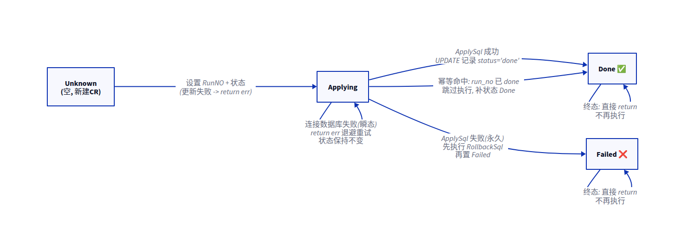
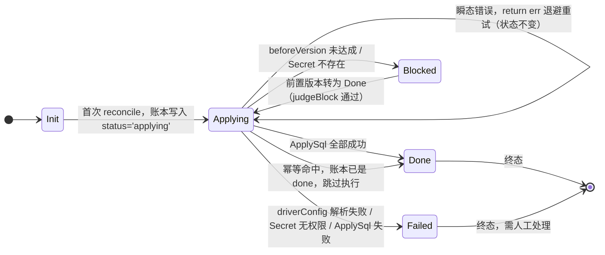

# db-migration-operator

用 Kubernetes CRD 声明式管理数据库 schema 迁移。

毕业设计「数据库演进自动化运维平台」的核心组件 —— 这个仓库是它的 Operator 部分。



---

## 它解决什么问题

线上改表出事故，基本是两类：

**乱序** —— 版本 7 还没跑完就跑版本 8，DDL 在错误的结构上执行。传统做法靠人记顺序，或者把顺序写死进脚本。

**半执行** —— 一个迁移里有 5 条 ALTER，第 3 条挂了。库停在中间状态：既不是迁移前，也不是迁移后。

---

## 做法

### 顺序靠声明，不靠人记

CR 里用 `beforeVersion` 声明前置版本。控制器每轮 reconcile 先查账本里前置版本的状态，不是 `Done` 就停在 `Blocked` 轮询等待，**不硬跑**。前置版本转 `Done` 后自动继续，并发 `BlockCleared` 事件。

```yaml
spec:
  version: 8
  beforeVersion: 7      # 7 没 Done 就一直等
```

### 放弃回滚，改前滚单语义

DDL 回滚本身不安全。半执行状态下回滚可能丢数据 —— 比如 `ADD COLUMN` 成功、后面那步失败，回滚要 `DROP COLUMN`，而那一列可能已经有写入。

所以整个回滚域被删掉，只保留前滚：

- 捕获 MySQL 的 `1060`（duplicate column）/ `1061`（duplicate key）/ `1091`（can't drop）当作「已达成」跳过 —— **重入幂等**，同一个迁移跑第二遍不会报错
- 失败信息带 `applied N lines`，直接定位到半执行的哪一行

### 凭据不落盘，且不放大 RBAC

库密码放 Secret。控制器读取时走 `APIReader` 绕开 manager 的 cache —— 否则为了缓存 Secret，得把 `secrets` 的 RBAC 权限放大到全命名空间 `list`/`watch`。现在只需要 `get`。

---

## 状态机



图源在 `docs/`（`.d2` 和 `.mmd` 两份）。

---

## 快速开始

需要一个能连通的 Kubernetes 集群（本地 Kind 即可）。

```bash
# 1. 准备数据库凭据
kubectl create secret generic mysql-credentials \
  --from-literal=password='<your-db-password>'

# 2. 装 CRD 并启动控制器
make install
make run

# 3. 提交一个迁移
kubectl apply -f config/samples/db_v1_schemamigration.yaml

# 4. 看状态
kubectl get schemamigration schemamigration-sample -o jsonpath='{.status.phase}'
```

`config/samples/tests/` 下还有四个场景样例：幂等探针、失败边界、瞬时锁、多列清理。

---

## CRD

```yaml
apiVersion: db.migration.dev/v1
kind: SchemaMigration
metadata:
  name: add-remark-column
spec:
  name: test1                    # 账本里的迁移名
  changeType: Expand             # Expand | Contract | Mixed
  driver: mysql                  # 目前完整支持 mysql
  driverConfig:
    host: mysql.example.com
    port: 3306
    user: root
    database: testdb
    tls: skip-verify
    passwordSecretRef:
      name: mysql-credentials    # 密码从哪个 Secret 取
      key: password
  version: 8                     # 本次迁移的版本号，>= 1
  beforeVersion: 7               # 可选，前置版本
  applySql:
    - "alter table test_data add `remark` varchar(100) default null"
```

| 字段 | 说明 |
|------|------|
| `version` | 单调递增的版本号，最小 1 |
| `beforeVersion` | 前置依赖。账本里它的状态不是 `Done` 就停在 `Blocked` |
| `applySql` | 至少一条。按顺序执行，全部成功才算迁移完成 |
| `driverConfig` | 结构由 driver 决定，不写死进 CRD schema |
| `changeType` | 标记迁移类型，配合 Expand-Contract 模式使用 |

---

## 架构

```
cmd/main.go                        manager 入口
api/v1/                            SchemaMigration CRD 类型
internal/controller/               reconcile 状态机
internal/version/                  版本串规范化 + 版本范围判断（纯逻辑，不碰数据库）
internal/adapter/                  driverConfig 解析 / DSN 构建 / 取服务器版本 / 账本读写 / DDL 执行
internal/resolver/                 Secret 读取（走 APIReader，绕开缓存）
```

**加一种数据库不用改控制器。** 版本检测：adapter 负责取原始版本串，version 包负责规范化与范围判断，两者都按 driver 名注册：

```go
DefaultCheckerManager.Register("mysql",    NewMysqlChecker(),    MysqlVersionRange)
DefaultCheckerManager.Register("postgres", NewPostgresChecker(), PostgresVersionRange)
// adapter 的注册同理：DefaultAdapterManager.Register("mysql", NewMysqlDriver)
```

---

## 设计取舍

**为什么 `driverConfig` 用 `runtime.RawExtension` 而不是写进 CRD schema？**
不同数据库的连接参数结构差别大（MySQL 有 TLS 模式、PostgreSQL 有 sslmode 和 search_path）。写进 schema 就要为每种 driver 加一堆可选字段，加一种库改一次 CRD。现在由 driver 自己的 ConfigFactory 解析，CRD schema 保持稳定。

**为什么 `Blocked` 要轮询而不是 watch？**
被依赖的版本状态记在数据库账本表里，不在 Kubernetes 里，没法 watch。轮询间隔 10 秒 —— 迁移是低频操作，这个开销可以接受。

**为什么瞬态错误 `return err` 而不是直接置 `Failed`？**
连接不上、临时锁冲突这类问题会自己消失，交给 controller-runtime 的指数退避重试。只有确定不会自愈的（driverConfig 解析失败、Secret 无权限、SQL 执行失败）才落 `Failed`。

---

## 已知限制

**`Failed` 是终态，改对 spec 也不会自动重试。** CR 进了 `Failed` 之后 `reconcile` 直接返回，即使把 spec 改对也起不来，得人工清 status。这是有意的（不让自动重试掩盖真问题），但缺一个「条件变化后自动拉回」的机制。

**PostgreSQL 尚未完成独立验收。** 配置解析、账本、DDL 执行与影子预演代码均已存在，但只在 MySQL 上做过完整验收；PostgreSQL 链路需要在独立测试库中按 E9 验证，未验证前不宣称可用。

**没有版本覆盖冲突检测。** 如果两个 CR 声明了同一个 `version` 但 SQL 不同，现在不会拦。

**没做多副本 leader election 的故障演练。** 只在单机 Kind 和自建 K8s 上验证过单副本运行。

---

## 开发

```bash
make test        # gofmt + vet + envtest 上的单元测试
make test-e2e    # 需要本地 Kind 集群
make lint        # golangci-lint（含 logcheck 自定义插件）
make manifests   # 重新生成 CRD / RBAC
make build       # 编译 manager 二进制
make docker-build docker-push IMG=<your-registry>/db-migration-operator:tag
```

测试分三层：

- `internal/version/*_test.go` — 版本检测的表驱动测试，纯函数，不依赖集群
- `internal/adapter/mysql_config_test.go` — DSN 构建，覆盖 TLS 模式和特殊字符转义
- `internal/controller/*_test.go` — envtest 起真 apiserver，覆盖 CRD 校验、非法 `changeType` 的失败边界、终态幂等
- `test/e2e/` — Kind 集群上的端到端（需要 Docker）

---

## License

Apache License 2.0
